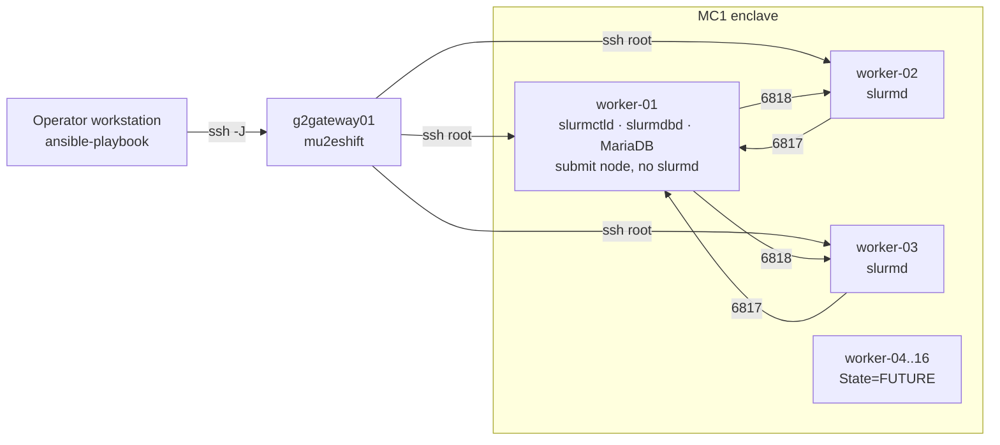

# Design

Slurm on the Mu2e MC1 trigger worker cluster, deployed with Ansible from an
operator workstation.

## Topology

| Port | Listener | Opened to |
|------|----------|-----------|
| 6817/tcp | slurmctld (worker-01) | cluster nodes (zone `10_mc1_cluster`) |
| 6818/tcp | slurmd (compute) | cluster nodes |
| 6819/tcp | slurmdbd (worker-01) | loopback only |
| 3306/tcp | MariaDB (worker-01) | loopback only (`bind-address=127.0.0.1`) |
| 60001–63000/tcp | srun on the submit node | cluster nodes |

## Decisions

| ID | Decision | Why |
|----|----------|-----|
| D1 | Slurm | User choice. |
| D2/D4 | worker-01 runs slurmctld, slurmdbd and job submission only, with no slurmd | User choice. The controller is never starved by job load. |
| D3 | All access by ProxyJump as `mu2eshift@g2gateway01`, root on the workers | User rule. Root is required for packages, accounts and services. |
| D5 | slurmdbd with MariaDB on worker-01 | User choice. Slurm has no SQLite backend. Gives `sacct`, associations and limits. |
| D6 | Job accounts: `mu2eshift`, `mu2edaq` and a new local `mu2ebatch` | User choice. `AccountingStorageEnforce=associations,limits` means only these accounts (and root) can submit. |
| D7 | Ansible, with `--check --diff` as the default | User choice. Gives idempotency and a reviewable plan before every change to production nodes. |
| D8 | `auth/munge` | Supported by every Slurm version EPEL might ship. |
| D9 | Packages from the SLAM-mirrored EPEL 9 | Signed and maintained through dnf. Preflight requires Slurm 22.05 or newer. |
| D10 | Configless (`enable_configless`, `slurmd --conf-server`) | There is no shared filesystem, and one copy of `slurm.conf` cannot drift. |
| D11 | Workers 04–16 declared `State=FUTURE` | Bringing a node online is an inventory move plus a re-run. |
| D16 | Slurm traffic goes to the project's own firewalld zone `10_mc1_cluster`, whose sources are the cluster members' /32 addresses; it allows ssh, 6817, 6818 and 60001–63000 | SLAM Puppet owns the zones that would otherwise match (`50_FNAL`, target REJECT). Zones that match by source are dispatched in name order, so `10_` wins. A Puppet `--noop` run on 2026-10-07 showed no changes. |
| D17 | A running Puppet agent is a preflight warning, not a failure | SLAM Puppet manages only root, its own packages and services, and firewalld; it does not touch slurm, munge, MariaDB or local users. |
| D19 | CVMFS client 2.14.1 from a local, sha256-verified RPM bundle (`scripts/mc1-cvmfs-fetch-rpms`), version-locked | Same as Slurm: the install does not depend on the enclave reaching cvmrepo, and EL9 and EL10 get the same release. |
| D20 | Repositories mounted statically from `/etc/fstab` at `/cvmfs/<repo>` (`cvmfs_config setup noautofs`), options `_netdev,nodev,nofail` | Batch jobs see a mount that is always there; no autofs map competes with SLAM Puppet, and the mount points are created by the role. `nofail` keeps a dead squid from blocking boot. |
| D21 | Repositories `mu2e` and `fermilab.opensciencegrid.org`; no config repository (`CVMFS_CONFIG_REPOSITORY=`) | Mu2e setup scripts take products from `fermilab`. Without autofs, a config repository would have to be mounted before the others; the stratum 1 list and keys in `cvmfs-config-default` suffice. |
| D22 | Proxy: `CVMFS_CLIENT_PROFILE=single` (WLCG WPAD) unless `mc1_cvmfs_http_proxy` is set | WPAD returns the Fermilab squids for on-site addresses, so no squid name is hard-coded. The role checks WPAD and stratum 1 reachability before installing and stops if neither answers. |
| D23 | Cache at `/var/lib/cvmfs`, quota 20000 MB, checked against free space (+15%) before install | Workers 17–18 have no free space left in `os_vg` for a dedicated LV. The quota and location are per-host overridable. |

## Mechanisms

- **Fixed IDs before packages.** The `accounts` role creates `munge` and
  `slurm` with the configured UID/GID before any RPM is installed, so the
  package scriptlets reuse them. Preflight refuses to run if any ID is held by
  a different name on any node.
- **One MUNGE key, no copies off-cluster.** The key is generated once on
  worker-01 (1 KiB from `/dev/urandom`). The run reads it with `slurp` and
  writes it on each compute node with `base64 -d` from stdin. Both tasks are
  `no_log`, and checksums decide whether a node needs the key, so re-runs do
  not churn.
- **Database password stays on worker-01.** It is generated into
  `/etc/slurm/.slurmdbd-db.pw` (0600) and rendered into `slurmdbd.conf`
  (0600 slurm). The SQL is idempotent (`CREATE … IF NOT EXISTS`, then
  `ALTER USER`).
- **Hardware from facts.** NodeName lines use each compute node's gathered
  socket, core, thread and memory facts. RealMemory is the total memory
  minus `slurm_node_mem_reserve_mb`. A per-host `slurm_node_spec` overrides
  the facts. FUTURE nodes copy the first compute node's hardware unless
  `slurm_future_node_spec` is set.
- **Config changes.** A changed `slurm.conf` or `cgroup.conf` restarts
  slurmctld, because adding nodes needs a restart on older Slurm versions.
  It then runs `scontrol reconfigure`, so each slurmd fetches the new files.
- **Puppet guard.** If `puppet.service` is running, preflight fails, since
  Puppet could revert local users, firewall rules or services. Setting
  `mc1_puppet_policy=warn` overrides this.

## Not applicable

This project is infrastructure-as-code. It has no C/C++ library, Python
bindings, CMake build or long-running local service, so the usual
`start-`/`stop-` scripts and CMake targets do not exist here.

## Known limits

- Home directories are local to each node. Job output lands on the compute
  node that ran the job. A shared filesystem is an open question.
- `--check` on a fresh node cannot preview tasks that depend on files the
  packages would create. Those are reported as ignored errors.
- A `--limit` run needs `mc1_cluster_addrs` set, because firewall sources
  come from the facts of all cluster nodes.
